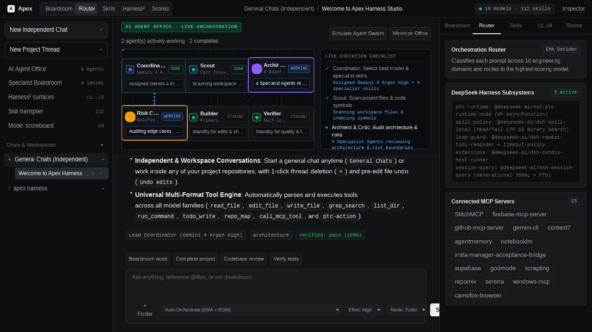
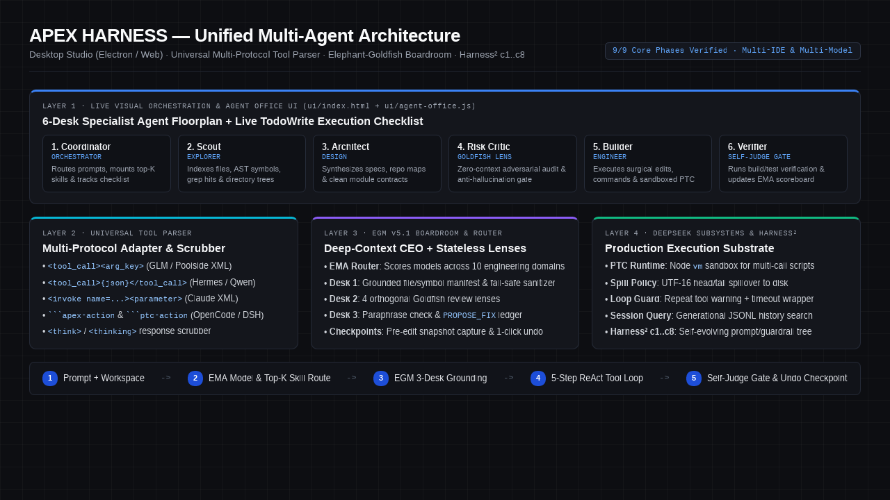

<div align="center">

# Apex Harness

**A Unified Multi-Agent AI Engineering Studio, Live Agent Office, and Cross-IDE Harness Substrate**

[](#verification)
[](#prerequisites)
[](#live-ai-agent-office--orchestration-visualization)
[](./LICENSE)

[Quick Start](./SETUP.md) &nbsp;&middot;&nbsp; [Architecture](#architecture-overview) &nbsp;&middot;&nbsp; [Agent Office UI](#live-ai-agent-office--orchestration-visualization) &nbsp;&middot;&nbsp; [Acceptance Matrix](docs/verification/acceptance-matrix.md) &nbsp;&middot;&nbsp; [Full Setup Guide](./SETUP.md)

</div>

---

**Apex Harness** unifies multi-model routing, cross-IDE skill/MCP loading, deterministic pre-edit safety checkpoints, a 6-agent **AI Agent Office** floorplan, and an **Elephant-Goldfish Model (EGM v5.1)** boardroom into a single local-first Web + Electron desktop application.

Instead of binding you to one model provider or hiding execution behind cryptic logs, Apex Harness lets you watch specialized agents route, explore, critique, edit, and verify your codebase in plain English — or start an independent, repository-free session anytime.


---

## Key Capabilities

### 1. Live AI Agent Office & Orchestration Visualization
Built in [`ui/agent-office.js`](./ui/agent-office.js), [`ui/index.html`](./ui/index.html), and [`ui/styles.css`](./ui/styles.css), the live floorplan visualizes six specialist workstations and an animated task pipeline:
- **Coordinator** (`ORCHESTRATOR`): Classifies the task domain, mounts top-K relevant skills, and updates the live **Execution Checklist** (`TodoWrite`).
- **Scout** (`EXPLORER`): Indexes repository files, AST symbols, grep results, and directory trees.
- **Architect** (`DESIGN`): Maps module contracts, repository structure (`RepoMap`), and implementation boundaries.
- **Risk Critic** (`GOLDFISH LENS`): Runs stateless zero-context reviews to surface edge cases, synthetic fallbacks, and hallucinated references.
- **Builder** (`ENGINEER`): Executes surgical `edit_file` / `write_file` changes, shell commands, and sandboxed JavaScript programmatic tool batches (`ptc-action`).
- **Verifier** (`SELF-JUDGE GATE`): Runs automated verification checks, enforces non-stub output quality, and updates the **EMA Model Scoreboard**.

Animated signal packets travel along SVG circuit connectors between desks whenever tasks transfer between agents, and you can preview the full choreography anytime via **Simulate Agent Swarm**.



---

### 2. Universal Multi-Protocol Tool Parser & Scrubber
Different LLM families emit incompatible tool-call syntaxes. [`server/harness/universal-tool-parser.ts`](./server/harness/universal-tool-parser.ts) normalizes and scrubs **6 tool & reasoning formats** before anything renders in the chat UI, preventing raw `<tool_call>` XML or chain-of-thought tags from leaking into responses:
- **Poolside / GLM / Qwen XML**: `<tool_call>read_file<arg_key>path</arg_key><arg_value>...</arg_value></tool_call>`
- **Hermes / Qwen JSON-in-XML**: `<tool_call>{"name": "...", "arguments": {...}}</tool_call>`
- **Truncated / Unclosed `<tool_call>` blocks**
- **Anthropic / Claude XML**: `<function_calls><invoke name="..."><parameter name="...">...</parameter></invoke></function_calls>`
- **Fenced Action Blocks**: ```` ```apex-action ```` and ```` ```ptc-action ````
- **Reasoning Scrubbers**: `<think>...</think>` and `<thinking>...</thinking>`

Cross-IDE tool names (`Read`, `Edit`, `Write`, `Grep`, `Glob`, `Bash`, `TodoWrite`, `RepoMap`) are mapped uniformly into the 9 canonical runtime actions (`read_file`, `write_file`, `edit_file`, `grep_search`, `list_dir`, `run_command`, `call_mcp_tool`, `todo_write`, `repo_map`) inside a 5-step ReAct execution loop.

---

### 3. Architecture Overview



| Subsystem | Module(s) | What It Does |
| :--- | :--- | :--- |
| **Shared Typed Contracts** | [`shared/apex-contracts.ts`](./shared/apex-contracts.ts) | Defines canonical execution states, 10 engineering roles, 6 agent office roles, provider configs, and completion evidence schemas. |
| **Workspace & Local API Security** | [`server/harness/workspace-security.ts`](./server/harness/workspace-security.ts) | Enforces `realpathSync`/`lstatSync` canonical path containment (blocking `../`, external paths, sibling-prefix confusion, and symlink escapes), loopback Origin/CSRF checks, per-session tokens, and 1 MiB body caps. |
| **Async Process Manager** | [`server/harness/process-manager.ts`](./server/harness/process-manager.ts) | Replaces synchronous `execSync` with `AbortSignal`-aware async child process execution, process-tree termination (`taskkill /T /F`), 256 KiB output ceilings, secret env stripping, and `turbo`/`auto_edit`/`ask` permission policies. |
| **Unified Execution Lifecycle** | [`server/harness/execution-manager.ts`](./server/harness/execution-manager.ts) | Tracks persistent `executionId` state transitions (`queued -> planning -> running -> paused -> cancelling -> cancelled / completed / failed`), hierarchical `AbortController` propagation, and crash recovery (`apex-executions.json`). |
| **6-Agent DAG & 10-Role Router** | [`server/harness/agent-dag-orchestrator.ts`](./server/harness/agent-dag-orchestrator.ts) | Decomposes tasks into a 6-agent DAG (`Coordinator` -> parallel `[Scout \|\| Architect]` -> `Critic` -> `Builder` -> `Verifier`), manages 10-role model routing, and stores provider API keys in an AES-256-GCM encrypted vault (`apex-provider-secrets.enc.json`). |
| **Completion Evidence Builder** | [`server/harness/completion-evidence.ts`](./server/harness/completion-evidence.ts) | Produces structured `CompletionEvidenceReport` ledgers from actual modified files, git diffs, executed test exit codes, and post-implementation review verdicts. |
| **App Server, IDE Workbench & SSE** | [`server/apex-app-server.ts`](./server/apex-app-server.ts), [`ui/index.html`](./ui/index.html) | Serves the Agent Office, IDE Workbench (File Explorer, Code Editor, Search, Terminal, Git Diff), 10-Role Router UI, and live `execution` + `office` SSE streams. |
| **Multi-Step Tool Engine** | [`server/apex-llm-engine.ts`](./server/apex-llm-engine.ts) | Executes ReAct tool rounds, captures pre-edit file snapshots for 1-click undo (`revertTurnCheckpoint`), and runs multi-protocol failover across gateways/CLIs. |
| **EGM v5.1 & Post-Impl Review** | [`server/harness/egm-boardroom.ts`](./server/harness/egm-boardroom.ts) | Runs pre-execution Desk 1–3 grounding and independent post-implementation diff/test review (`runPostImplementationEgmReview`), never defaulting to approval when unavailable. |
| **DeepSeek-Harness Subsystems** | [`server/harness/deepseek-subsystems.ts`](./server/harness/deepseek-subsystems.ts) | Isolates Programmatic Tool Calling (`executePtcProgram`) and HMAC-SHA256 signed Cordis plugins inside Node `--permission` child processes, plus UTF-16 spill files, repeat-call guards, and FTS session queries. |
| **Universal Skill & MCP Bridge** | [`server/harness/universal-skill-loader.ts`](./server/harness/universal-skill-loader.ts), [`mcp-client-bridge.ts`](./server/harness/mcp-client-bridge.ts) | Enforces dynamic token budgets (`maxContextBudgetTokens`), conflict detection, driver compatibility checks, and `AbortSignal`-propagating JSON-RPC 2.0 MCP calls. |
| **Harness² `c1..c8` Controlled Evolution** | [`server/harness/harness2-bridge.ts`](./server/harness/harness2-bridge.ts), [`harness2/`](./harness2) | Enforces proposal validation gates (`proposeHarnessImprovement` -> `validateHarnessProposal` -> `promoteHarnessProposal`) and snapshot rollback (`rollbackHarnessSnapshot`) across `c1..c8`. |
| **Fleet Registry & Clean-Room Sanitizer** | [`server/harness/apex-fleet-sync.ts`](./server/harness/apex-fleet-sync.ts) | Loads configured gateway/CLI models without persisting raw API keys to disk and maintains an isolated clean-room environment for strict-firewall models. |

---

## Independent & Project Workspaces

- **Independent Chats (`General Chats`)**: Brainstorm architectures, run research, or compare models without binding the session to any local codebase.
- **Project Workspaces & Integrated IDE Workbench**: Browse files, edit & save with automatic checkpoints, run project-wide text search, inspect `git status`/`git diff`, and execute terminal/test commands directly inside the **IDE Workbench** tab.
- **1-Click Thread Management & Safety Checkpoints**: Delete individual threads cleanly (`×`), pause/resume/cancel running DAG executions, inspect any tool step output inline, and revert file modifications from any assistant turn.

---

## Verification

Run the complete **29-test automated verification suite** (9 core architecture phases + 20 master security, orchestration, cancellation, and completion-evidence scenarios):

```bash
npm run test:apex
# or directly via Node 24:
node --experimental-strip-types --test server/apex-harness.node-test.mjs server/apex-master-verification.node-test.mjs
```

---

## Setup & Configuration

Read **[`SETUP.md`](./SETUP.md)** for full step-by-step instructions covering prerequisites, `.env` gateway setup (zero committed secrets), desktop launching, and troubleshooting.

---

## License & Attribution

Licensed under the **Apache License 2.0** (see [`LICENSE`](./LICENSE) and [`NOTICE`](./NOTICE)). Built on top of open-source multi-agent infrastructure with integrated subsystems inspired by OpenClaude, OpenCodex, Hermes-Agent, OpenCode, and DeepSeek-Harness.
