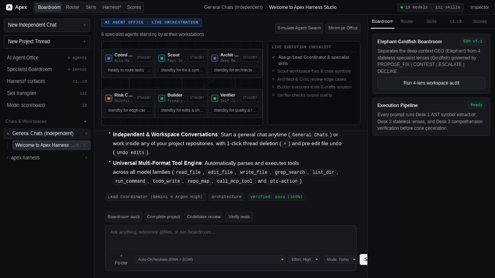

<div align="center">

# Apex Harness

**A Unified Multi-Agent AI Engineering Studio, Live Agent Office, and Cross-IDE Harness Substrate**

[](#verification)
[](#prerequisites)
[](#live-ai-agent-office--orchestration-visualization)
[](./LICENSE)

[Quick Start](./SETUP.md) &nbsp;&middot;&nbsp; [Architecture](#architecture-overview) &nbsp;&middot;&nbsp; [Agent Office UI](#live-ai-agent-office--orchestration-visualization) &nbsp;&middot;&nbsp; [Full Setup Guide](./SETUP.md)

</div>

---

**Apex Harness** unifies multi-model routing, cross-IDE skill/MCP loading, deterministic pre-edit safety checkpoints, a 6-agent **AI Agent Office** floorplan, and an **Elephant-Goldfish Model (EGM v5.1)** boardroom into a single local-first Web + Electron desktop application.

Instead of binding you to one model provider or hiding execution behind cryptic logs, Apex Harness lets you watch specialized agents route, explore, critique, edit, and verify your codebase in plain English — or start an independent, repository-free session anytime.



---

## Key Capabilities

### 1. Live AI Agent Office & Orchestration Visualization
Built in [`ui/agent-office.js`](./ui/agent-office.js), [`ui/index.html`](./ui/index.html), and [`ui/styles.css`](./ui/styles.css), the live floorplan visualizes six specialist workstations and an animated task pipeline:
- **Coordinator** (`ORCHESTRATOR`): Classifies the task domain, mounts top-K relevant skills, and updates the live **Execution Checklist** (`TodoWrite`).
- **Scout** (`EXPLORER`): Indexes repository files, AST symbols, grep results, and directory trees.
- **Architect** (`DESIGN`): Maps module contracts, repository structure (`RepoMap`), and implementation boundaries.
- **Risk Critic** (`GOLDFISH LENS`): Runs stateless zero-context reviews to surface edge cases, synthetic fallbacks, and hallucinated references.
- **Builder** (`ENGINEER`): Executes surgical `edit_file` / `write_file` changes, shell commands, and sandboxed JavaScript programmatic tool batches (`ptc-action`).
- **Verifier** (`SELF-JUDGE GATE`): Runs automated verification checks, enforces non-stub output quality, and updates the **EMA Model Scoreboard**.

Animated signal packets travel along SVG circuit connectors between desks whenever tasks transfer between agents, and you can preview the full choreography anytime via **Simulate Agent Swarm**.


---

### 2. Universal Multi-Protocol Tool Parser & Scrubber
Different LLM families emit incompatible tool-call syntaxes. [`server/harness/universal-tool-parser.ts`](./server/harness/universal-tool-parser.ts) normalizes and scrubs **6 tool & reasoning formats** before anything renders in the chat UI, preventing raw `<tool_call>` XML or chain-of-thought tags from leaking into responses:
- **Poolside / GLM / Qwen XML**: `<tool_call>read_file<arg_key>path</arg_key><arg_value>...</arg_value></tool_call>`
- **Hermes / Qwen JSON-in-XML**: `<tool_call>{"name": "...", "arguments": {...}}</tool_call>`
- **Truncated / Unclosed `<tool_call>` blocks**
- **Anthropic / Claude XML**: `<function_calls><invoke name="..."><parameter name="...">...</parameter></invoke></function_calls>`
- **Fenced Action Blocks**: ```` ```apex-action ```` and ```` ```ptc-action ````
- **Reasoning Scrubbers**: `<think>...</think>` and `<thinking>...</thinking>`

Cross-IDE tool names (`Read`, `Edit`, `Write`, `Grep`, `Glob`, `Bash`, `TodoWrite`, `RepoMap`) are mapped uniformly into the 9 canonical runtime actions (`read_file`, `write_file`, `edit_file`, `grep_search`, `list_dir`, `run_command`, `call_mcp_tool`, `todo_write`, `repo_map`) inside a 5-step ReAct execution loop.

---

### 3. Architecture Overview


| Subsystem | Module(s) | What It Does |
| :--- | :--- | :--- |
| **App Server & SSE Stream** | [`server/apex-app-server.ts`](./server/apex-app-server.ts) | Serves the UI, manages workspace/independent conversations (`POST`, `PATCH`, `DELETE`), and streams live `office` + `step` SSE events. |
| **Multi-Step Tool Engine** | [`server/apex-llm-engine.ts`](./server/apex-llm-engine.ts) | Executes ReAct tool rounds, captures pre-edit file snapshots for 1-click undo (`revertTurnCheckpoint`), and runs failover across gateways/CLIs. |
| **EMA Task-to-Model Router** | [`server/decider/apex-orchestrator-router.ts`](./server/decider/apex-orchestrator-router.ts) | Classifies prompts across 10 engineering domains and selects top-scoring models using live Exponential Moving Average (EMA) weights. |
| **EGM v5.1 Boardroom** | [`server/harness/egm-boardroom.ts`](./server/harness/egm-boardroom.ts) | Separates deep-context CEO execution from 4 stateless zero-context Goldfish audit lenses governed by `PROPOSE_FIX \| CONTEST \| ESCALATE \| DECLINE`. |
| **DeepSeek-Harness Subsystems** | [`server/harness/deepseek-subsystems.ts`](./server/harness/deepseek-subsystems.ts) | Provides sandboxed Node `vm` Programmatic Tool Calling (`executePtcProgram`), UTF-16 head/tail spill files (`applySpillPolicyToText`), repeat-call/timeout guards (`RepeatToolReminderGuard`), Cordis host plugins, and FTS session queries. |
| **Universal Skill & MCP Bridge** | [`server/harness/universal-skill-loader.ts`](./server/harness/universal-skill-loader.ts), [`mcp-client-bridge.ts`](./server/harness/mcp-client-bridge.ts) | Auto-discovers, deduplicates, and transpiles skills across ecosystems and connects to JSON-RPC 2.0 stdio MCP servers. |
| **Harness² `c1..c8` Substrate** | [`server/harness/harness2-bridge.ts`](./server/harness/harness2-bridge.ts), [`harness2/`](./harness2) | Initializes and validates the 8 canonical self-evolving harness surfaces (`systemprompt.md`, `guardrails.md`, `LongTermMEMORY.md`, `tool_guidance.md`, sub-agents, skills, scripts, plugins). |
| **Fleet Registry & Clean-Room Sanitizer** | [`server/harness/apex-fleet-sync.ts`](./server/harness/apex-fleet-sync.ts) | Loads configured gateway/CLI models without persisting raw API keys to disk and maintains an isolated clean-room environment for strict-firewall models. |

---

## Independent & Project Workspaces

- **Independent Chats (`General Chats`)**: Brainstorm architectures, run research, or compare models without binding the session to any local codebase.
- **Project Workspaces**: Auto-discovers registered git repositories or folders added via `+ Folder` / `APEX_EXTRA_WORKSPACE_ROOTS`, keeping threads grouped cleanly without duplicate entries.
- **1-Click Thread Management & Safety Checkpoints**: Delete individual threads cleanly (`×`), inspect any tool step output inline, and revert file modifications from any assistant turn.

---

## Verification

Run the 9-phase automated verification suite (covering Drive/virtual filesystem compatibility, key-redacted fleet syncing, skill transpilation, EMA routing & self-judge gates, Python `harness2` validation, EGM boardroom conferencing, DeepSeek subsystems, surgical `edit_file` checkpoints, JSON-RPC 2.0 MCP client bridge, and multi-protocol XML/JSON tool parsing):

```bash
node --test --experimental-strip-types server/apex-harness.node-test.mjs
```

---

## Setup & Configuration

Read **[`SETUP.md`](./SETUP.md)** for full step-by-step instructions covering prerequisites, `.env` gateway setup (zero committed secrets), desktop launching, and troubleshooting.

---

## License & Attribution

Licensed under the **Apache License 2.0** (see [`LICENSE`](./LICENSE) and [`NOTICE`](./NOTICE)). Built on top of open-source multi-agent infrastructure with integrated subsystems inspired by OpenClaude, OpenCodex, Hermes-Agent, OpenCode, and DeepSeek-Harness.
