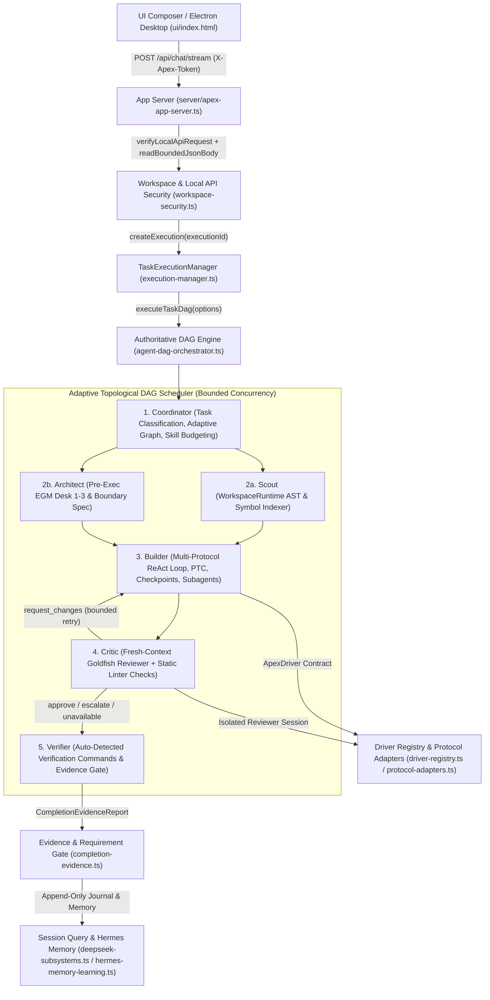

# Authoritative Execution Runtime Architecture

## 1. Single Production Execution Spine

Apex Harness enforces a single authoritative execution engine (`executeTaskDag` in `server/harness/agent-dag-orchestrator.ts`) invoked by both the production SSE endpoint (`POST /api/chat/stream` in `server/apex-app-server.ts`) and integration test suites.

---

## 2. Core Architectural Invariants

1. **No Duplicate Orchestration Paths**: `POST /api/chat/stream` delegates directly to `executeTaskDag()`. Every SSE event (`execution`, `plan`, `egm`, `step`, `office`, `delta`, `done`, `error`) is emitted from callbacks driven by `executeTaskDag()`.
2. **Adaptive Graph Complexity**:
   - `fast_path` (trivial Q&A or independent chat): `Coordinator -> Builder -> Verifier` (skips unnecessary repository-wide Scout/Architect/Critic overhead by marking them `skipped` with explicit rationale).
   - `standard` (targeted single-file edit/debug): `Coordinator -> Scout -> Builder -> Critic -> Verifier`.
   - `full_engineering` (multi-file feature, architecture, or security task): Full 6-agent parallel DAG (`Coordinator -> [Scout || Architect] -> Builder -> Critic -> Verifier`).
3. **Genuine Agent Session Independence**: Every active DAG node receives its own `sessionId` (`sess_${executionId}_${node.id}`), assigned driver (`driverId`), model (`assignedModelId`), and scoped context window.
4. **Honest Fresh-Context EGM Review**:
   - Deterministic static checks (`TODO`/`FIXME` stubs, empty files, command exit codes) are explicitly labelled `deterministic_static_check`.
   - Independent Goldfish review invokes a fresh driver session containing **only** the task requirement, changed file contents, git diff, and executed command outputs—never the Elephant's conversation history.
   - If no live reviewer model is reachable, the reviewer returns `outcome: "unavailable"`, `reviewerAvailable: false`, and completion is capped at `implemented_not_verified` (never `implemented_and_verified`).
5. **Idempotency-Aware Failover**: If a provider fails *before* any workspace mutation (`write_file`, `edit_file`, mutating `run_command`), the driver router transparently fails over to the next candidate model. If a failure occurs *after* workspace mutation, automatic blind retry is blocked unless the turn checkpoint is rolled back first.
6. **OS-Backed Secret Storage**: Provider API keys are encrypted via Windows DPAPI (`ProtectedData` on `win32`), macOS Keychain (`security` on `darwin`), Linux `secret-tool`, or a CSPRNG 256-bit `.master-key` (`0o600`) fallback—never derived from `hostname` or `username`.
